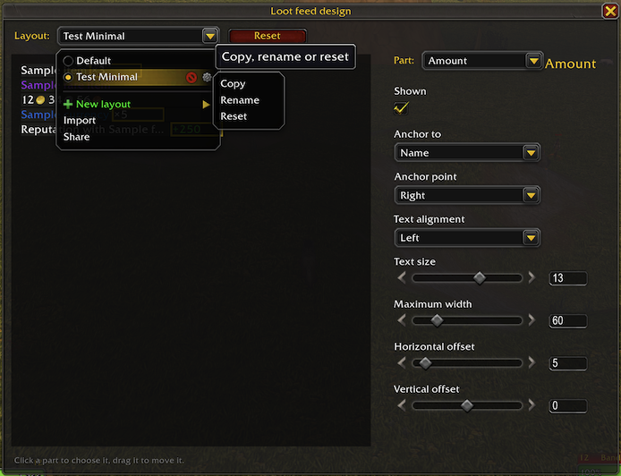
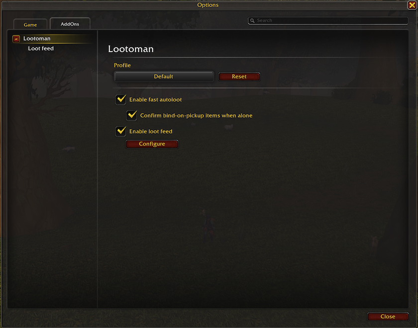
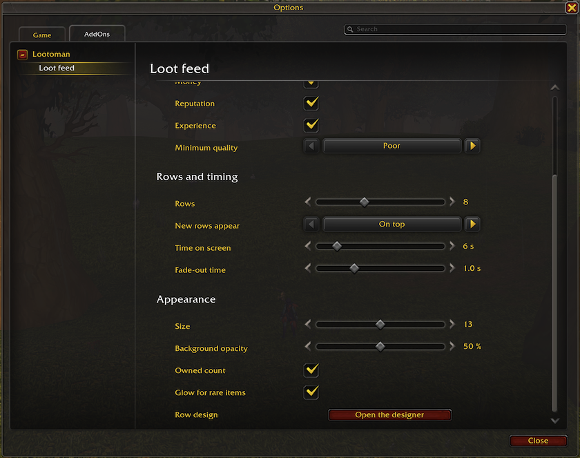

# Lootoman

Lootoman is a World of Warcraft addon about loot: fast autoloot, a loot feed you can design, and junk thrown away or sold in a click. It looks and feels like the default game interface.

## Features

### Fast autoloot

- When the game loots automatically (the Auto Loot option, or the auto loot key), Lootoman picks up everything at once and the loot window stays hidden. It takes one item at a time, as fast as the server answers, so large pulls do not disconnect you.
- Before taking an item it checks that there is room: a partial stack of the same item, a free slot in a general bag, a profession bag that takes the item, or the reagent bag for crafting reagents (on WoW Forever, a herb bag in the reagent bag's slot takes only herbs).
- What does not fit stays in the loot window, which then opens with the items that are left. So does everything after an error, such as full bags or a roll that is still going on.
- Items that bind when picked up are confirmed for you when you are not in a group (an option, on by default). In a group, the loot window opens and you decide.

### Loot feed

- What you pick up appears next to the centre of the screen and fades out: items, currencies, money, reputation and, if you want, experience. Repeated items merge into one row with a count. Money from merchants, mail, trade, the auction house and banks is not loot and is not shown.
- Options: what the feed shows, the lowest item quality it shows, how many rows are shown at once (3 to 20; a full feed fades its oldest rows out), the fill direction (bottom to top or top to bottom; with icons also left to right and right to left), time on screen, fade-out time, size, background opacity, and a glow for rare items.
- **Compact view**: the Icons layout shows square icons only, with the amount and the owned count on each (or beside it, up to an icon's size away, each with a background of its own if you like). Big numbers are short, cut and never rounded: 850, 1.23K, 12.34K, 123K, 1.23M. Money is a number and a coin: 78 copper, 1.23 silver, 1.02 gold, then whole gold, then 1.23K gold.
- **Usable items stay**: with *Keep usable items* on, an item this character can use right now stays in the feed's first place until you click it: left to dismiss it, right to use it (out of combat; in a fight, a right click works only for the item that was there when it began). Items that start a quest (with the bags' quest mark), recipes you can learn, containers you can open, and pets, mounts, toys, appearance sets and heirlooms not in your collection yet; each kind can be turned off. Several wait under each other, with a badge counting them, and the others keep fading in the places after it. Such an item shows even below the minimum quality, counts down as you use it, and goes when it is used up, learned or its quest is taken.
- Point at a row to see the item's or currency's tooltip, or money, experience and reputation in full; the feed waits while you do. Clicks go through to the game world, but for a kept item.
- The feed is placed with the game's Edit Mode, with its own position in every Edit Mode layout. Its options are also in its Edit Mode dialog.
- **Row designer** (`/lootoman design`, or the buttons on the loot feed's options page and in its Edit Mode dialog): click a part of the sample rows — icon, name, amount or owned count — to choose it, and drag it to move it. For each part, choose whether it is shown, what it is anchored to and at which point, its offsets, the icon's size as a share of the row's height, and a text's size, maximum width and alignment, and the amount's and the owned count's own background; for the rows, their height, width and gap. An Icons layout offers only the icon's size, the gap, the amount and the owned count. The feed follows every change at once.
- **Row layouts** have names and are shared by every profile; each profile uses one of them. New layouts start from the Large, Compact, Minimal or Icons template, and layouts can be copied, renamed, reset to their template and deleted. The layout Default always exists.
- **Low-space warnings**: while few general bag slots are free (2 or fewer by default), and if you want while few reagent bag slots are, a warning sits at the feed's edge where its oldest row is, after a kept item, and the rows stack after it. With icons it is a bag icon with the free slots, or, filling sideways, a line above the icons. Each kind has its own threshold.

### Junk

- Junk is every gray item and every item you marked as junk, but not a gray item you marked "not junk" (to keep it for transmog, say).
- **Toss button** on the loot window: always, only when your bags are full (something of the loot did not fit, or no general bag has a free slot), or never. Small, on the window's title bar next to its close button; or large, outside the window, with its size, side and offset. It follows the loot window wherever Edit Mode puts it.
- **Toss window**: your bags like a bag window, in two sections: the junk on top, everything else below, each cheapest first, with each stack's price under it and each section's total. The price is what deleting loses: the better of the merchant's price and Auctionator's auction price after the auction house's cut (a bound item has only the merchant's). Quest items and items in equipment sets are never listed. It opens next to the loot window from the toss button, or anywhere with `/lootoman toss`.
- **Marking**: right-click an item to move it between the junk and everything else, or drag it there. Moved into the junk, it is marked as junk; moved out, the mark goes, and a gray item is marked "not junk".
- **Deleting**: drag an item out of the toss window to delete its stack. A gray stack goes at once; anything else asks first, and rare and better items ask for the game's confirmation word, as the game does. One drag deletes one stack, and nothing is deleted while the cursor holds something or when the item has moved.
- **Sell-junk button** at merchants, with the look and place of the game's own: a click sells the junk; Shift-click opens the sell window to pick what to sell, and sells nothing by itself (an option swaps the two). With *Sell junk at merchants* on, the junk is sold as soon as a merchant's window opens. Bags you set to "ignore for junk selling" in the game keep their junk.
- **Sell window**, next to the merchant, laid out like the toss window with the merchant's prices: *Sell junk* sells the upper section and closes the window; a right click or a drag moves an item between the sections, as in the toss window. Refundable items and items no merchant buys are not listed. Selling goes one stack at a time and stops when the merchant's window closes. A chat line sums up each sale and warns when more was sold than the merchant can buy back (12 stacks); `/lootoman sales` lists this session's sales.
- **Junk list** in the options: every item marked as junk or as not junk, with a Remove button for each and *Clear list*. Marks belong to the profile.
- Auction prices come from [Auctionator](https://www.curseforge.com/wow/addons/auctionator) when it is installed; without it, the merchant's price.

### Options and profiles

- One options page in the game's AddOns settings: the profile on top, chosen from a menu like Edit Mode's layout menu (copy, rename, reset, delete, new profile, import, share), with a Reset button beside it; then a switch for each feature, with its main options under it and a button that opens its own page.
- Every character can use its own profile; new characters use the Default profile.
- **Share** makes a text of the current profile to give to another character or player. Tick what goes into it: each feature's settings, the loot feed's position and the layout it uses, and any of your row layouts. **Import** reads such a text, shows what it holds and takes what you tick, into a new profile or into the current one. When an imported layout's name is taken, choose for each one: keep both, replace yours, or keep yours. Row layouts can also be shared and imported on their own, from the designer.
- Changes apply at once, without `/reload`.

### Languages and clients

English and Russian. For World of Warcraft (retail) and WoW Forever.

### Commands

- `/lootoman` or `/ltm`: open the options.
- `/lootoman design`: open the loot feed's row designer.
- `/lootoman toss`: open the toss window.
- `/lootoman sales`: list what was sold this session.
- `/lootoman debug on` or `off`: turn debug messages on or off for all characters.
- `/lootoman selftest`: check the addon against the game client. Its output helps with bug reports.

## Screenshots

The loot feed after picking up herbs, leather and experience:

The loot feed in Edit Mode, with its options in the Edit Mode dialog:

The row designer, with its menu of row layouts:

The options: the main page, and the loot feed's own page:

## Status

An early version: features and options may still change between versions. Please report problems on [GitHub Issues](https://github.com/virasio/WoW-Lootoman/issues) or in the comments on [Lootoman's CurseForge page](https://www.curseforge.com/wow/addons/lootoman), with the output of `/lootoman selftest`.

## License

[MIT](LICENSE)

Libraries bundled in `Libs/` keep their own licenses:

- [LibStub](https://www.wowace.com/projects/libstub): public domain.
- [LibEditMode](https://github.com/p3lim-wow/LibEditMode) by p3lim: [its license](Libs/LibEditMode/LICENSE.txt).
