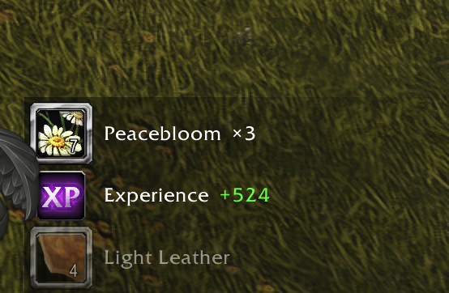
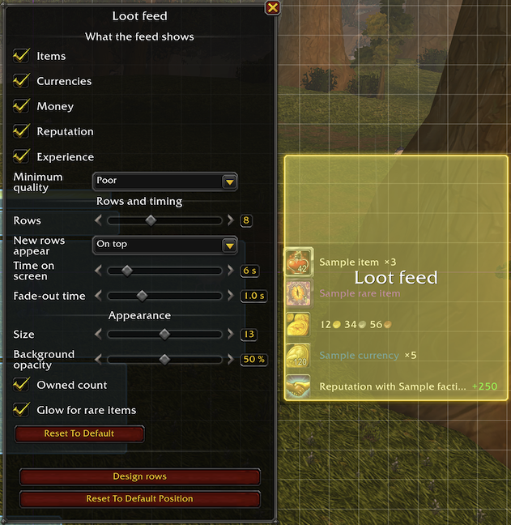

# Lootoman

Lootoman is a World of Warcraft addon about loot: fast autoloot, a loot feed you can design, and junk thrown away or sold in a click. It looks and feels like the default game interface.

## Features

### Fast autoloot

- When the game loots automatically (the Auto Loot option, or the auto loot key), Lootoman picks up everything at once and the loot window stays hidden. It takes one item at a time, as fast as the server answers, so large pulls do not disconnect you.
- Before taking an item it checks that there is room: a partial stack of the same item, a free slot in a general bag, a profession bag that takes the item, or the reagent bag for crafting reagents (on WoW Forever, a herb bag in the reagent bag's slot takes only herbs).
- What does not fit stays in the loot window, which then opens with the items that are left. So does everything after an error, such as full bags or a roll that is still going on.
- Items that bind when picked up are confirmed for you when you are not in a group (an option, on by default). In a group, the loot window opens and you decide.
- If the game's own Auto Loot is off when you open the options, a red box under fast autoloot says where to turn it on and holds the game's Auto Loot checkbox and Auto Loot key, as on the game's Controls page (or, where the game does not let addons change them, a button that opens that page).

### Loot feed

- What you pick up appears next to the centre of the screen and fades out: items, currencies, money, reputation and, if you want, experience. Repeated items merge into one row with a count. Money from merchants, mail, trade, the auction house and banks is not loot and is not shown.
- **Feed looks** hold every setting of the feed: what it shows, the lowest item quality it shows, the kept usable items, how many rows are shown at once (3 to 20; a full feed fades its oldest rows out), its view (rows or icons) and fill direction (bottom to top or top to bottom; with icons also left to right and right to left), time on screen, fade-out time, size, background opacity, a glow for rare items, the low-space warnings, and the design of its rows. Looks have names and are shared by every profile; each profile uses one. Choose it on the options page or in the feed's Edit Mode dialog, from a menu like Edit Mode's layout menu: edit, copy, rename, reset to the defaults and delete a look, start a new one, and share or import looks as text. The look Default always exists.
- **Compact view**: a look of icons shows square icons only, with the amount and the owned count on each (or beside it, up to an icon's size away, each with a background of its own if you like). Big numbers, the owned count's too, are short, cut and never rounded: 850, 1.23K, 12.34K, 123K, 1.23M. Money is a number and a coin: 78 copper, 1.23 silver, 1.02 gold, then whole gold, then 1.23K gold.
- **Usable items stay**: with *Keep usable items* on, an item this character can use right now stays at the start of the feed, after any warnings, until you click it: left to dismiss it, right to use it (in a fight, a right click works only for the item that was there when it began; another item's tooltip says its right click works after the fight). Items that start a quest (with the bags' quest mark), recipes you can learn, containers you can open, and pets, mounts, toys, appearance sets and heirlooms not in your collection yet; each kind can be turned off. Several wait under each other, with a badge counting them, and the others keep fading in the places after it. On rows without an icon, the marks sit at the row's edges. Such an item shows even below the minimum quality, counts down as you use it, and goes at once when it is used up or leaves your bags; one you cannot use any more (learned, or its quest taken) fades out like any row.
- Point at a row to see the item's or currency's tooltip, or money, experience and reputation in full; the feed waits while you do. Clicks go through to the game world, but for a kept item.
- The feed is placed with the game's Edit Mode, with its own position in every Edit Mode layout. Its Edit Mode dialog chooses its look.
- **Look window** (*Edit* in a look's menu, or `/lootoman design` for the profile's look): sample rows of every kind on the left, and two tabs. *Feed* holds the look's settings. *Design* holds the chosen part: click a part of the sample rows (icon, name, amount or owned count) to choose it, and drag it to move it. For each part, choose whether it is shown, what it is anchored to and at which point, its offsets, the icon's size as a share of the row's height, a text's size, maximum width and alignment, and whether the owned count counts the bags and bank or the bags only; for the rows, their height, width and gap. The rows, the amount and the owned count can each have a background of their own, in a colour you pick and with its own opacity. A look of icons offers only the icon's size, the gap, the amount and the owned count. The window edits the look it was opened for, and the feed follows every change at once. *Reset* returns the look to its defaults; *Share* makes a text of it.
- **Low-space warnings**: while few general bag slots are free (3 or fewer by default), or few reagent bag slots (2 or fewer), one warning row sits at the feed's edge where its oldest row is, then a kept item, and the rows stack after them. It follows the look's design like any row: a bag with a red border, "Few free bag slots" as its name, and as its amount the free slots of each kind that is low, general white and reagent green ("3+2"); its tooltip names each. Each kind can be turned off and has its own threshold.

### Junk

- Junk is every gray item and every item you marked as junk, but not a gray item you marked "not junk" (to keep it for transmog, say).
- **Sort window button** on the loot window: only when your bags are full (something of the loot did not fit, or no general bag has a free slot; the default), always, or never. Large, next to the window's top right corner and as big as the loot window's items (the default); or small, on the window's title bar next to its close button. It follows the loot window wherever Edit Mode puts it.
- **Sort window** (*Sort junk*): your bags like a bag window, in two sections: the junk on top, everything else below, each cheapest first, with each stack's price under it and each section's total. The price is what deleting loses: the better of the merchant's price and Auctionator's auction price after the auction house's cut (a bound item has only the merchant's). Quest items and items in equipment sets are never listed. It opens next to the loot window from its button, or anywhere with `/lootoman toss`.
- **Marking**: right-click an item to move it between the junk and everything else, or drag it there. Moved into the junk, it is marked as junk; moved out, the mark goes, and a gray item is marked "not junk".
- **Deleting**: drag an item out of the sort window to delete its stack. A gray stack goes at once; anything else asks first, and rare and better items ask for the game's confirmation word, as the game does. One drag deletes one stack, and nothing is deleted while the cursor holds something or when the item has moved.
- **At merchants**, choose how junk is sold: as soon as a merchant's window opens, with the sell-junk button, or by picking what to sell in the sort window (the default). The sell-junk button has the look and place of the game's own; a click opens the sort window, and Shift-click sells the junk (when the button sells, the two swap). Its tooltip says which is which. Bags you set to "ignore for junk selling" in the game keep their junk.
- **At a merchant the sort window** sits next to the merchant with the merchant's prices: *Sell junk* sells the upper section and closes the window; a right click or a drag moves an item between the sections. Refundable items and items no merchant buys are not listed. Selling goes one stack at a time and stops when the merchant's window closes. A chat line sums up each sale and warns when more was sold than the merchant can buy back (12 stacks); `/lootoman sales` lists this session's sales.
- **Junk list**, a window of its own opened from the options or from the sort window's title bar: every item marked as junk or as not junk, with a Remove button for each and *Clear list*. Marks belong to the profile.
- Auction prices come from [Auctionator](https://www.curseforge.com/wow/addons/auctionator) when it is installed; without it, the merchant's price.

### Options and profiles

- One options page in the game's AddOns settings, with no subpages: the profile on top, chosen from a menu like Edit Mode's layout menu (copy, rename, reset, delete, new profile, import, share); then fast autoloot, junk and the loot feed, each with its options under it. What does not fit is in Lootoman's own windows: a feed look's window and the junk list.
- Every character can use its own profile; new characters use the Default profile.
- **Share** makes a text of the current profile to give to another character or player. Tick what goes into it: each feature's settings, the loot feed's position and the look it uses, and any of your feed looks. **Import** reads such a text, shows what it holds and takes what you tick, into a new profile or into the current one; texts from earlier versions are read too. When an imported look's name is taken, choose for each one: keep both, replace yours, or keep yours. Feed looks can also be shared and imported on their own, from the look menu.
- Changes apply at once, without `/reload`.

### Languages and clients

English and Russian. For World of Warcraft (retail) and WoW Forever.

### Commands

- `/lootoman` or `/ltm`: open the options.
- `/lootoman design`: open the window of the loot feed's look.
- `/lootoman toss`: open the sort window.
- `/lootoman sales`: list what was sold this session.
- `/lootoman debug on` or `off`: turn debug messages on or off for all characters.
- `/lootoman selftest`: check the addon against the game client. Its output helps with bug reports.

## Screenshots

The loot feed after picking up herbs, leather and experience:

The loot feed in Edit Mode:

## Status

An early version: features and options may still change between versions. Please report problems on [GitHub Issues](https://github.com/virasio/WoW-Lootoman/issues) or in the comments on [Lootoman's CurseForge page](https://www.curseforge.com/wow/addons/lootoman), with the output of `/lootoman selftest`.

## License

[MIT](LICENSE)

Libraries bundled in `Libs/` keep their own licenses:

- [LibStub](https://www.wowace.com/projects/libstub): public domain.
- [LibEditMode](https://github.com/p3lim-wow/LibEditMode) by p3lim: [its license](Libs/LibEditMode/LICENSE.txt).
