# Lootoman

Lootoman is a World of Warcraft addon about loot: fast autoloot, a loot feed you can design, junk thrown away or sold in a click, and on WoW Forever, sparkles on what you are about to loot. It looks and feels like the default game interface.

## Features

### Fast autoloot

- When the game loots automatically (the Auto Loot option, or the auto loot key), Lootoman picks up everything at once and the loot window stays hidden. It takes one item at a time, as fast as the server answers, so large pulls do not disconnect you.
- Before taking an item it checks that there is room: a partial stack of the same item, a free slot in a general bag, a profession bag that takes the item, or the reagent bag for crafting reagents (on WoW Forever, a herb bag in the reagent bag's slot takes only herbs).
- What does not fit stays in the loot window, which then opens with the items that are left. So does everything after an error, such as full bags or a roll that is still going on.
- Items that bind when picked up are confirmed for you when you are not in a group (an option, on by default). In a group, the loot window opens and you decide.
- Fast autoloot works for every loot the game would take by itself: corpses, containers, herbs, ore and fish. A short note under its switch on the options page says that the loot window stays hidden.
- If the game's own Auto Loot is off while fast autoloot is on, a box under fast autoloot says in red that fast autoloot needs it, and holds the game's Auto Loot checkbox and Auto Loot key, as on the game's Controls page (or, where the game does not let addons change them, a button that opens that page); a grey line says where the game keeps these options. Once it is on, the box says all is set, and next time it is not shown. With fast autoloot off, there is no box.

### Loot feed

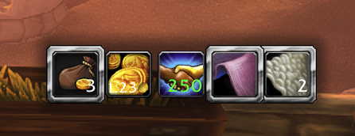

- What you pick up appears next to the centre of the screen and fades out: items, currencies, money, reputation and, if you want, experience. Repeated items merge into one row with a count, and all junk (gray items and items you marked as junk) gathers in one row, "Junk", which lists them in its tooltip. When much is looted at once, the rows come in one after another and leave the same way. Money from merchants, mail, trade, the auction house and banks is not loot and is not shown.
- Quest items carry the bags' gold quest border on their icon. Point at a row to see the item's or currency's tooltip, or money, experience and reputation in full; the feed waits while you do. Shift-click an item row to put its link into the chat; right-click a piece of gear you just looted to equip it. Other clicks go through to the game world, but for a kept item.
- **Feed looks** hold every setting of the feed and the design of its rows. Looks have names and are shared by every profile; each profile uses one, chosen on the options page from a menu like Edit Mode's layout menu: edit, copy, rename, reset to the defaults and delete a look, start a new one, and share or import looks as text. The look Default always exists.
- **Look window** (*Edit* beside the look on the options page, *Edit* in a look's menu, the feed clicked in Edit Mode, or `/ltm feed`): at the top the look it edits, from the same menu, with *Apply* to make the profile use another look, and *Reset Position* for the feed's place; the sample rows of every kind on the right, in front of the feed's background and on a dark or light backdrop, centred, drawn at 100, 150 or 200 percent and widened over the whole window if you like (the window can be resized from its corner), and four tabs on the left:
  - *Content*: what the feed shows, the lowest item quality it shows, junk in one row, the kept usable items, and the low-space warning;
  - *Appearance*: its view (rows or icons) and fill direction (bottom to top or top to bottom; with icons also left to right and right to left), how many rows or icons are shown at once (3 to 20; a full feed fades its oldest ones out), the gap between rows or icons, a glow for rare items, and a background behind the rows, in a colour and opacity you pick (it reaches half a row past the rows on every side and fades out there, or ends sharply just past them without the fade, and follows them smoothly);
  - *Timings*: the delay between rows coming in, time on screen, fade-out time;
  - *Layout*: the chosen part. Click a part of the sample rows (icon, name, amount or owned count) to choose it, and drag it to move it. For each part, choose whether it is shown, what it is anchored to and at which point, its offsets, the icon's size as a share of the row's height and whether it wears its quality border, a text's size, style (plain, with a shadow, or outlined), maximum width and alignment, and whether the owned count counts the bags and bank or the bags only; for the rows, their height and width. The rows, the amount and the owned count can each have a background of their own, in a colour you pick and with its own opacity; the rows can also have a border, in its own colour, width (1 to 4 pixels) and opacity. A look of icons offers only the icon's size and quality border, the amount and the owned count.

  The window edits the look it was opened for, and the feed follows every change at once; while the window is open, the feed shows its sample rows where it stands, as in Edit Mode.
- **Compact view**: a look of icons shows square icons only, with the amount and the owned count on each (or beside it, up to an icon's size away, each with a background of its own if you like). Big numbers, the owned count's too, are short, cut and never rounded: 850, 1.23K, 12.34K, 123K, 1.23M. Money is a number and a coin: 78 copper, 1.23 silver, 1.02 gold, then whole gold, then 1.23K gold. A text wider than its icon is drawn smaller until it fits, so it never runs over the next icon.
- **Usable items stay**: with *Keep Usable Items* on, an item this character can use right now stays at the start of the feed, after any warning, until you click it: left to dismiss it, right to use it (in a fight, a right click works only for the item that was there when it began; another item's tooltip says its right click works after the fight). Items that start a quest (with the bags' quest mark), recipes you can learn, containers you can open, and pets, mounts, toys, appearance sets and heirlooms (on retail) not in your collection yet; each kind can be turned off. Several wait under each other, with a badge counting them, and the others keep fading in the places after it. On rows without an icon, the marks sit at the row's edges. Such an item shows even below the minimum quality, counts down as you use it, and goes at once when it is used up or leaves your bags; one you cannot use any more (learned, or its quest taken) fades out like any row.
- The feed is placed with the game's Edit Mode, with its own position in every Edit Mode layout.
- **Low-space warning**: one warning row sits at the feed's edge where its oldest row is, then a kept item, and the rows stack after them. It shows while any of three thresholds you turn on is reached: free slots in all bags, in the general bags (on by default, at 3 or fewer: only they take gear and junk), or in the reagent bag. Its number is a text you write with tokens, such as `{general}+{reagent|1eff00}` (the default, "3+2") or `{free} / {total}`, each named with what it stands for under the field; its tooltip lists every kind of bag; a click opens the junk window while junk management is on. It follows the look's design like any row: a bag with a red border and "Few free bag slots" as its name.

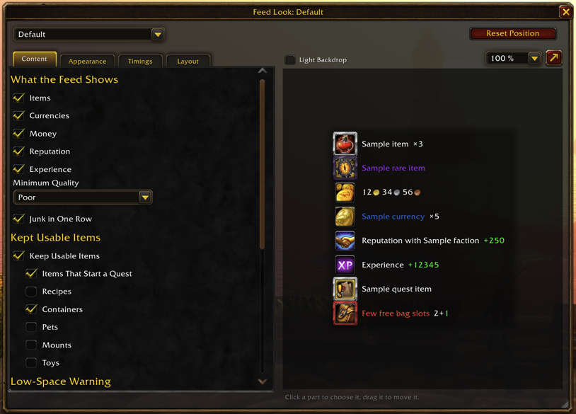

### Junk

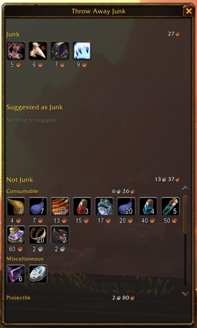

- Junk is every gray item and every item you marked as junk, but not an item you marked "not junk". Lootoman also suggests what else could go; a suggestion becomes junk only when you send it there.
- *Enable Junk Management* turns all of it on or off; turned off, the game's own sell-junk button is back.
- **One junk window, the same groups in its modes.** Your bags like a bag window: *Junk* on top (with the junk a quest in your log still wants at its bottom, under a highlighted line); *Suggested as Junk*, one group per reason, each with its total and a *To Junk* button; and *Not Junk*, grouped by kind of item. Each cheapest first, with each stack's price under it. Items in equipment sets are never listed.
- **Suggestions**, each one a switch on the options page: items of quests you have done (an item that starts a quest you have done, quest items no quest needs any more); leftovers from quests you have done; soulbound gear your class cannot use; recipes you know and mounts, pets, toys and heirlooms you already have; food, drink, potions, elixirs, flasks and bandages 20 levels or more below yours. Leftovers, and known or outgrown items you could trade, are suggested only when the auction house pays little more for them than a merchant. Never suggested: a marked item, one in an equipment set, a refundable one, an appearance you have not collected, or one a quest in your log still wants. With [QuestieDB](https://www.curseforge.com/wow/addons/questiedb) installed, Lootoman knows every quest an item is for; without it, it reads your quest log and remembers the quests you turn in.
- **Moving items**: left-click a suggestion to send it to the junk, right-click it to keep it; left-click junk that a quest still wants to keep it; drag any item between the groups. The tooltip says why an item is suggested and what its clicks do.
- **The junk window** is one window of one size, its title saying its mode: *Throw Away Junk*, *Sell Junk* (only at a merchant) and *Junk List*. A gear by its close button switches to the junk list and back to your bags, where the window is. A merchant opening while it throws away switches it to selling, and back when the merchant closes; it closes with what it was opened beside (the loot window, the merchant).
- **Throwing away** (*Throw Away Junk*): moves mark items for good. Drag an item out of the window to delete its stack: a gray stack goes at once; anything else asks first, and rare and better items ask for the game's confirmation word, as the game does. One drag deletes one stack, and nothing is deleted while the cursor holds something or when the item has moved. Opened by the loot window, it names the most valuable item left in the loot and checks the junk worth less. The price is what deleting loses: the better of the merchant's price and Auctionator's auction price after the auction house's cut (a bound item has only the merchant's).
- **The loot window's button** opens the junk window to throw away, next to the loot window: only when your bags are full (something of the loot did not fit, or no general bag has a free slot; the default), always, or never. Large, next to the window's top right corner and as big as the loot window's items (the default); or small, on the window's title bar next to its close button. It follows the loot window wherever Edit Mode puts it.
- **The bag window's button** opens the junk window from the bags: to sell beside a merchant while one is open, else to throw away in the middle of the screen. Small, in the bag window's title next to its close button (the default); large, above the bag window; large, on its own, placed and sized in Edit Mode; or never. `/ltm junk`, the minimap icon's menu and a click on the loot feed's low-space warning open it the same way.
- **At merchants**, choose how junk is sold: as soon as a merchant's window opens, with the sell-junk button, or by picking what to sell in the junk window (the default). Selling without the window sells gray and marked items only. The sell-junk button has the look and place of the game's own; a click opens the junk window to sell, and Shift-click sells the junk (when the button sells, the two swap). Its tooltip says which is which. Bags you set to "ignore for junk selling" in the game keep their junk.
- **Selling** (*Sell Junk*) sits next to the merchant with the merchant's prices, the junk group called *To Sell* there: moves are for this sale only, and for good with Shift held; *Sell Junk* sells the *To Sell* group, what was moved there for this sale too, and closes the window. Refundable items and items no merchant buys are not listed. Selling goes one stack at a time and stops when the merchant's window closes; a sale cut short says how many stacks were left, in a dialog with OK and in red in the chat, and back at a merchant within a minute they are in *To Sell* again (and the sell button sells them), even an item that is not junk and was picked for that sale. A chat line sums up each sale and warns when more was sold than the merchant can buy back (12 stacks).
- **The junk list** (*Junk List*), opened with *Edit the Junk List* on the options page (beside the options) or with the gear, has two tabs: *Junk* and *Not Junk*, every item with that mark, in the bags or not, with a *Remove* button for each and *Clear List*. Add an item by dropping it there from your bags, or with the field: Shift-click an item, paste a link or type an item ID. Marks belong to the profile.
- **Share the junk list** as a text from the junk list, alone, or with a profile. Imported, it merges with your list or replaces it; when merging, each item marked otherwise in the text is shown with its tooltip, to keep your mark or take the text's.
- Auction prices come from [Auctionator](https://www.curseforge.com/wow/addons/auctionator) when it is installed; without it, the merchant's price.

### Gathering highlights (WoW Forever)

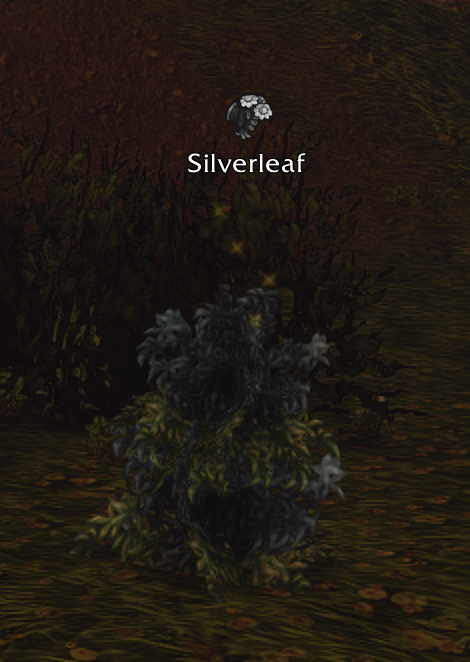

- The object you are about to loot sparkles with a few small gold stars: the one your Interact key would use, within about 15 yards. Herbs, ore veins, chests and quest objects all sparkle alike, each kind with its own switch under *Highlight Lootable Objects*. The sparkles are bright in reach, quieter further away, and faint on what you can't use yet (a locked chest, too little skill).
- *Only What You Can Gather* (on by default) lights herbs only with Herbalism, ore only with Mining and corpses only with Skinning; turn it off to see them anyway, say to help a friend who gathers.
- *Intensity* and *Sparkle Color*, right under the switch, set how bright the stars are and their colour (gold by default); the kinds are under *What to Highlight*.
- Over the stars, the object's interaction icon and its name under it (*Above the Object*: *Icon and name* by default, *Icon*, or *Nothing*), at an opacity of their own. The name's size, colour (white by default) and style are yours: the game's shadow, an outline, a thick outline, or a dark backdrop, so it reads over any landscape. The game's own icon stays off over a sparkling object, so you see one icon only.
- One object at a time: the game tells addons only about the one its soft targeting picks.
- Corpses you can skin now sparkle too (*Corpses to Skin*): once a corpse is looted, or if it has no loot, so you see which corpses others have looted. With too little skill they sparkle faintly.
- A quest object is one the game says a quest wants, or one the text of an unfinished objective in your quest log names, so it sparkles before you collect the first one. Chests are known by their cursor and name, and any object you loot that is none of the kinds counts as a chest from then on.
- To work, it turns on the game's soft targeting of objects (Options, Controls, *Enable Interact Key*) and a few related game options while highlights are on, and gives them back when you turn highlights off or log out; a setting you change yourself meanwhile stays yours. If soft targeting was off before, Lootoman pauses it next to a living creature or player and as a fight begins, so a spell cast without a target never lands on someone else. The soft target's nameplate is switched on only for an object that sparkles, and the game's interact icon over it (a herb leaf, a pickaxe) is switched off meanwhile, so nothing shows under the stars; your icons come back with the next target, and a vein you can't mine shows nothing.
- Other addons don't change what sparkles: with a nameplate addon the stars show all the same, and with another addon that lights objects you see both.

### Loot rolls

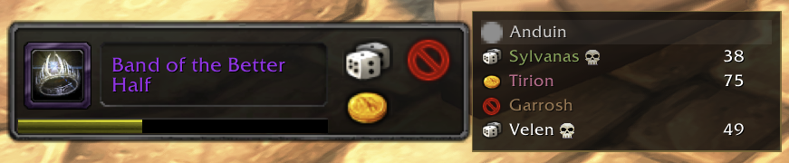

- Beside each of the game's loot roll frames, a panel shows who chose what on that roll and what they rolled, in class colours, as it happens: in a group of five a line per player (the game's icon for the choice, the roll, the leader, the winner's checkmark, your own line), in a raid a few short lines (who leads, how many needed, greed and pass with their counts, who has not chosen), each naming its players in its tooltip. The game's roll frames, their buttons and the bind question stay as they are.
- **Ninja detection**, off until you tick *Detect Ninja Looters*, marks a need that breaks the rules of the needer's class: an armor type not its own (or past the level it counts to, such as a warrior's mail past 40 on WoW Forever), a weapon type not its own, or primary stats it does not use (a dagger is a warrior's weapon, a dagger with Intellect is not). For a BoE item it says what the player did on the group's other BoE items, such as greeding one that fits them. It also marks a player who needs nearly everything in the group, and brings back a mark from the last group you were in with them until they play fair. In a raid, the marked players show as squares in class colours. Friends and guild members can be spared.
- **Ninja Rules** (`/ltm ninja`, or the button beside the checkbox, while the detection is on) sets, for each class, which armor types (up to which level), weapon types and primary stats count as its own, and which checks run, how strict they are, and from which quality items are judged.
- **Exceptions:** right-click a marked name to excuse a need the group agreed to; on leaving a group, a window lists its marked needs to excuse them there.

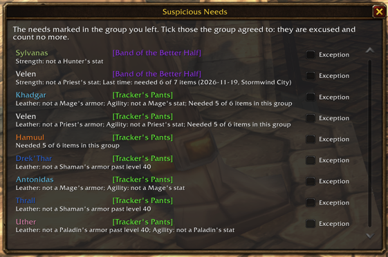

- **The Loot Rolls window**, where the game does not open a loot history window of its own (WoW Forever; retail opens the game's): once you have chosen on a roll, it opens (at the screen's left the first time, then where you put it, kept for the character) with that roll and the group's other rolls still going, and every item rolled on while it is open joins it at the top, each with its item, who won it with which button and roll (or *All passed*), and the panel's lines under it. Closed, it opens again at your next choice. *Show the Loot Rolls Window After Your Choice*, under the loot rolls' switch, turns it off.

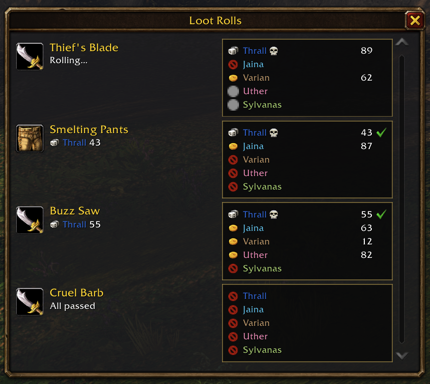

- **Roll History** (`/ltm rolls`, the button beside *Show Who Rolled What*, or the minimap menu): the rolls are kept by group, from joining to leaving (the newest 30 groups and 400 drops), and this window shows them: your groups newest first, each with its day, places and counts; the chosen group's players with their needs, greeds, passes, wins and marks, and its drops in time order with their time, place, winner and choices. Click a player for everything they did in your groups, group by group, or find them by name in the search box. Filter the drops by quality or to marked needs, excuse a marked need with its *Exception* checkbox (in any group: the marks it caused later follow), and delete a group or the whole history.

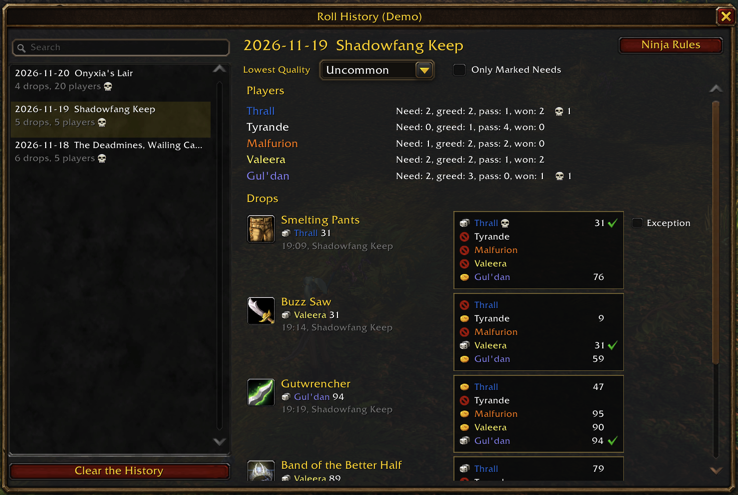

- **Moving the game's roll frames** (*Move the Loot Roll Frames in Edit Mode*, on by default): in Edit Mode, *Loot Roll Frames* moves them, a place for each layout (*Edit* beside the checkbox opens Edit Mode with it picked); until you move them, the game places them as always.

### Options and profiles

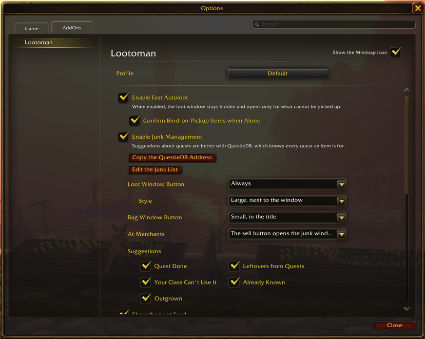

- One options page in the game's AddOns options, with no subpages: the profile on top, chosen from a menu like Edit Mode's layout menu (copy, rename, reset, delete, new profile, import, share); then a switch for fast autoloot, junk, the loot feed, gathering highlights on WoW Forever and the loot rolls, each with its options under it. What does not fit is in Lootoman's own windows: a feed look's window, the junk window, the ninja rules and the roll history. At the page's top right, *Show the Minimap Icon*, for this character.
- **The minimap icon**, Lootoman's own picture (the game's AddOns list shows it too), opens the options on a click; a right click opens a menu: *Options*, *Loot Feed Look*, *Junk*, *Ninja Rules*, *Roll History* and *Bug Report*. An entry, or a command, of a feature that is off asks to turn it on, with a button to the options. Drag it round the minimap's edge (a square minimap too, when a minimap addon makes it square); it stays where you put it. The game's addon compartment has the same entry, also with the icon hidden.
- Every character can use its own profile; new characters use the Default profile.
- **Share** makes a text of the current profile to give to another character or player. Tick what goes into it: each feature's options, the loot feed's position and the look it uses, and any of your feed looks. **Import** reads such a text, shows what it holds and takes what you tick, into a new profile or into the current one; texts from earlier versions are read too. When an imported look's name is taken, choose for each one: keep both, replace yours, or keep yours. Feed looks can also be shared and imported on their own, from the look menu.
- Changes apply at once, without `/reload`.

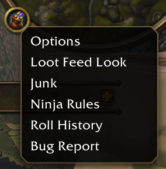

### Languages and clients

English and Russian. For World of Warcraft (retail) and WoW Forever.

### Commands

- `/ltm` or `/lootoman`: open the options.
- `/ltm feed`: open the loot feed's look window.
- `/ltm junk`: open the junk window.
- `/ltm ninja`: open the ninja rules.
- `/ltm rolls`: open the roll history.
- `/ltm report`: open the bug report window.
- `/ltm help`: list the commands.
- `/ltm debug help` lists the commands for testing and bug reports: `debug log` (the journal: errors and the extended log), `debug selftest`, `debug junk` (why an item is junk or not), `debug bags`, `debug rolls` (the open rolls and the group's last drops) and, on WoW Forever, `debug target`.

### Bug reports

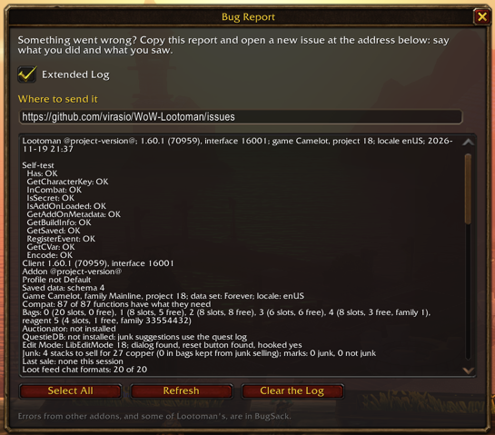

*Bug Report* in the minimap icon's menu (or `/ltm report`) opens a window with the whole report, ready to copy: the versions, a self-test, this session's errors, the extended log and the options that differ from their defaults; it names neither your character nor your realm. Turn on *Extended Log* there, do what goes wrong, and come back. Lootoman keeps its own errors always, and never fills the chat with debug lines.

## Status

An early version: features and options may still change between versions. Please report problems on [GitHub Issues](https://github.com/virasio/WoW-Lootoman/issues) or in the comments on [Lootoman's CurseForge page](https://www.curseforge.com/wow/addons/lootoman), with the text of the *Bug Report* window.

## License

[MIT](LICENSE)

Libraries bundled in `Libs/` keep their own licenses:

- [LibStub](https://www.wowace.com/projects/libstub): public domain.
- [LibEditMode](https://github.com/p3lim-wow/LibEditMode) by p3lim: [its license](Libs/LibEditMode/LICENSE.txt).
